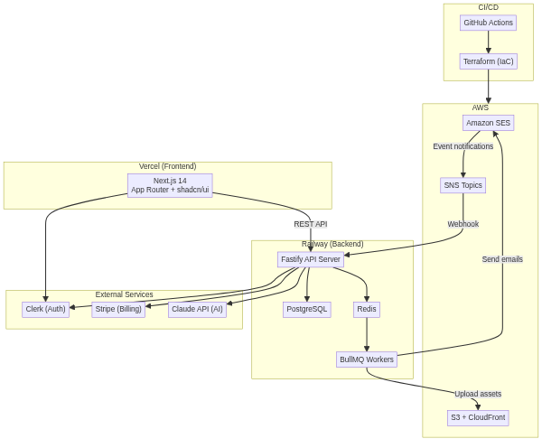
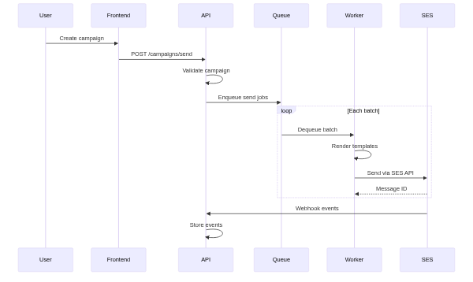
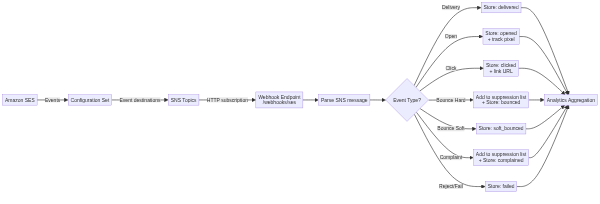
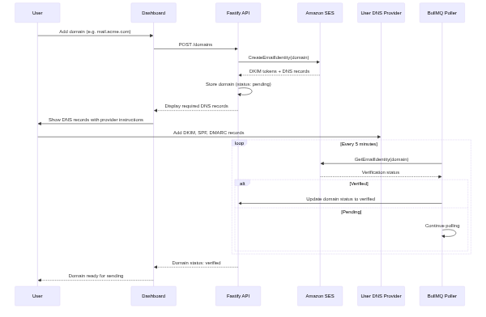
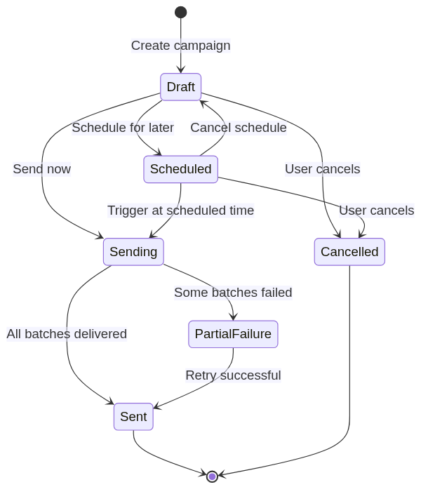
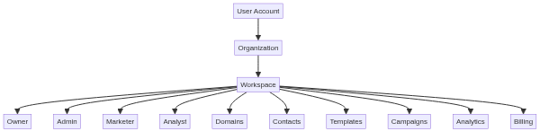
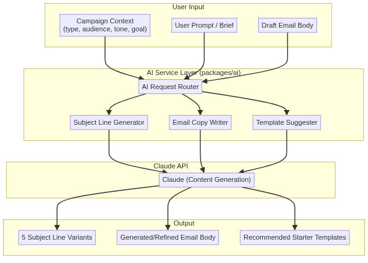
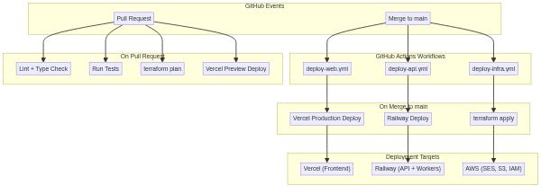
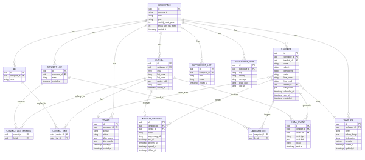

# SignalWave - System Design Document

## 1. Overview

SignalWave is an AI-first enterprise email campaign platform for SMBs, positioned between developer-only tools (Resend) and bloated ESPs (Mailchimp). It combines AI content generation and smart optimization with a full-featured campaign management platform.

---

## 2. Architecture

### 2.1 High-Level Architecture



### 2.2 Email Sending Pipeline



### 2.3 SES Event Tracking Flow



### 2.4 Custom Domain Verification Flow



### 2.5 Campaign Lifecycle State Machine



### 2.6 Auth & Multi-Tenancy Model



### 2.7 AI Features Architecture



### 2.8 CI/CD & Infrastructure Deployment Flow



### 2.9 Database Schema (ER Diagram)



---

## 3. Tech Stack

| Layer | Technology |
|---|---|
| Frontend | Next.js 14 (App Router) + TypeScript + Tailwind CSS + shadcn/ui |
| Template Editor | Unlayer React Email Editor |
| Backend API | Node.js + Fastify |
| Database | PostgreSQL (Railway) + Prisma ORM |
| Job Queue | BullMQ + Redis (Railway) |
| Email Sending | Amazon SES |
| Auth | Clerk (org/workspace hierarchy) |
| Billing | Stripe Billing |
| File Storage | AWS S3 + CloudFront |
| AI | Claude API (content generation); custom models (optimization) |
| Infra-as-Code | Terraform (AWS resources) |
| Monorepo | Turborepo |
| CI/CD | GitHub Actions |

---

## 4. Monorepo Structure

```
emailsignals/
├── apps/
│   ├── web/                    # Next.js 14 frontend (Vercel)
│   │   ├── app/                # App Router pages
│   │   ├── components/         # UI components (shadcn/ui)
│   │   └── lib/                # Frontend utilities
│   └── api/                    # Fastify backend API (Railway)
│       ├── src/
│       │   ├── routes/         # API route handlers
│       │   ├── services/       # Business logic
│       │   ├── workers/        # BullMQ job processors
│       │   ├── providers/      # SES, Stripe integrations
│       │   └── db/             # Prisma schema + migrations
│       └── prisma/
│           └── schema.prisma
├── packages/
│   ├── shared/                 # Shared types, constants, validation schemas
│   └── ai/                     # AI service layer (content gen + optimization)
├── infra/                      # Infrastructure-as-Code
│   ├── terraform/              # AWS resources (SES, S3, IAM)
│   ├── railway.toml            # Railway config
│   └── vercel.json             # Vercel config
├── .github/
│   └── workflows/
│       ├── deploy-web.yml
│       ├── deploy-api.yml
│       └── deploy-infra.yml
├── docs/
│   └── SYSTEM_DESIGN.md
├── turbo.json
└── package.json
```

---

## 5. Key Design Decisions

### 5.1 Custom Domain Model
Users bring their own domains. SignalWave does NOT send from a shared domain. This improves deliverability and brand trust. The verification flow uses SES domain identity APIs with background DNS polling via BullMQ.

### 5.2 Workspace-Scoped Isolation
All data (contacts, campaigns, templates, domains) is scoped to a workspace. Clerk provides the org/workspace hierarchy with built-in role management (Owner, Admin, Marketer, Analyst).

### 5.3 Event-Driven Email Tracking
SES Configuration Sets route events through SNS to a webhook endpoint. Events are processed and stored in PostgreSQL. Hard bounces and complaints trigger automatic suppression.

### 5.4 Rate-Limited Sending
Campaign sends are batched into BullMQ jobs with rate limiting. New domains use a warm-up schedule (gradual volume ramp) to build sender reputation.

### 5.5 AI from Day One
AI features ship in Phase 1 - subject line generation, email copy writing, and template suggestions - all powered by Claude API. Phase 2 adds smart send-time optimization and predictive engagement scoring.

---

## 6. Implementation Plan

### Phase 1 - MVP

The MVP delivers the core email campaign loop: sign up, verify domain, import contacts, build email, send campaign, track results.

#### Step 1: Project Scaffold
- Turborepo monorepo with `apps/web`, `apps/api`, `packages/shared`, `packages/ai`
- TypeScript, ESLint, Prettier configuration
- GitHub Actions CI/CD workflows for Vercel, Railway, and Terraform

#### Step 2: Infrastructure (`/infra`)
- Terraform modules for SES domain identity management, configuration sets, SNS topics, S3 bucket, and IAM roles
- GitHub Actions: `terraform plan` on PR, `terraform apply` on merge

#### Step 3: Auth + Org/Workspace (Clerk)
- Clerk integration with org/workspace hierarchy
- Roles: Owner, Admin, Marketer, Analyst
- Protected API routes with Clerk middleware

#### Step 4: Custom Domain Management
- `POST /domains` creates SES domain identity via AWS SDK
- Returns DKIM/SPF/DMARC records for user DNS setup
- Background worker polls DNS verification every 5 minutes (BullMQ)
- Domain health dashboard with status badges

#### Step 5: Contact Management
- CRUD contacts with custom fields (up to 50 per workspace)
- CSV import with field mapping (BullMQ background job)
- Contact lists, tags, duplicate detection on email
- Suppression list (hard bounces, complaints, unsubscribes)

#### Step 6: Template Editor (Unlayer)
- Unlayer React Email Editor integration
- Save/load templates to PostgreSQL
- 10+ starter templates
- Merge tag support (`{{first_name}}`, etc.)
- Template preview (desktop/mobile)

#### Step 7: Campaign Builder
- Step-by-step flow: Setup > Audience > Content > Review > Schedule > Confirm
- Subject line with personalisation tokens
- Preview text, UTM parameters
- Send test email (up to 5 addresses)
- Immediate send or schedule for later

#### Step 8: Email Sending Pipeline
- Campaign send creates BullMQ jobs (batched, rate-limited)
- Worker renders template per-recipient (merge tags)
- Sends via SES API using verified domain
- Auto-suppression check before each send
- Warm-up mode for new domains (gradual volume ramp)

#### Step 9: Event Tracking
- SES Configuration Set -> SNS -> webhook endpoint on Railway
- Process events: delivered, opened, clicked, bounced, complained, failed
- Store in PostgreSQL
- Auto-suppress hard bounces and complaints

#### Step 10: Analytics Dashboard
- Campaign summary: sent, delivered, open rate, click rate, bounce rate, unsubscribe rate
- Time-series chart (opens/clicks over time)
- Per-contact activity log

#### Step 11: Compliance
- Auto-inject unsubscribe link in every marketing email
- List-Unsubscribe header (RFC 8058)
- Hosted unsubscribe landing page (branded per workspace)
- CAN-SPAM physical address in footer

#### Step 12: Billing (Stripe)
- Plans: Starter ($29/mo, 10K emails), Growth ($79/mo, 50K emails)
- Usage tracking against monthly quota
- Overage billing ($1/1K emails)
- Stripe Customer Portal for self-service management

#### Step 13: AI Features
- **AI Subject Line Generator**: Claude API generates 5 subject line variants from campaign context
- **AI Email Copy Writer**: Generate/refine email body content from a prompt
- **AI Template Suggestions**: Recommend starter template based on campaign type/goal

---

### Phase 2 - Engagement & API

| Feature | Description |
|---|---|
| A/B Testing | Subject line testing, winner auto-selected by open rate |
| Segmentation | Attribute + behavioral contact filters |
| Scheduled Sends | Timezone-aware scheduling |
| REST API v1 | Public API + OpenAPI docs |
| Webhook Events | Outbound webhook events API |
| Advanced Analytics | Link heatmap, device breakdown, geo map |
| Preference Centre | Granular unsubscribe options |
| Smart Send-Time | AI-optimized send timing |
| Engagement Scoring | Predictive engagement scoring (AI) |

### Phase 3 - Enterprise & Scale

| Feature | Description |
|---|---|
| Automation | Drip/automation sequences |
| Conditional Content | Dynamic content blocks |
| Enterprise SSO | SAML 2.0 |
| Agency Billing | Multi-workspace agency billing |
| GDPR | Data export/erasure workflows |
| Deliverability AI | Predict inbox placement |
| NL Segmentation | AI-powered natural language segmentation |

---

## 7. Verification Plan

| # | Area | Verification |
|---|---|---|
| 1 | Auth | Sign up, create org/workspace, invite team member with role |
| 2 | Domain | Add domain, see DNS records, verify via SES |
| 3 | Contacts | Import CSV, view list, search, tag |
| 4 | Template | Build email in Unlayer, save, preview on mobile |
| 5 | Campaign | Create campaign, select audience, compose, send test email |
| 6 | Send | Send campaign, verify delivery via SES console |
| 7 | Events | Confirm open/click tracking, bounces auto-suppress |
| 8 | Analytics | View campaign stats dashboard |
| 9 | AI | Generate subject lines, generate email copy |
| 10 | Billing | Subscribe to plan, track usage, test overage |
| 11 | CI/CD | Push to main, verify Terraform applies, app deploys |
